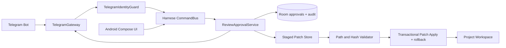

# Harnese Secure Review — Telegram approvals RFC v1
**الحالة:** تصميم قابل للتنفيذ؛ ليس ميزة مفعّلة في APK.
**المنتج:** Harnese Android (Kotlin/Compose), Android 9+, ARM64.
**المسؤولية:** تنفيذ مراجعات وتعديلات مشاريع الهاتف بأوامر Telegram دون منح البوت سلطة كتابة مباشرة.

## 1. ما هو موجود فعلاً؟
- `app/src/main/java/com/jarves/mh/model/Models.kt`: `ToolRequest(approvalId,sessionId,toolName,affectedPaths,commandPreview,risk)` و`ChangeItem` وفئات أحداث الموافقة.
- `MainViewModel.answerApproval(approved)`: تفويض الأداة في جلسة التنفيذ النشطة فقط.
- `WorkspaceCheckpoints.kt`: checkpoint + diff + Undo/Keep **بعد** تعديل الملفات.
- `AppPreferences.kt`: حفظ محادثات المشاريع في JSON.
> اعتماد تشغيل أداة (Tool approval) **ليس** اعتماد تثبيت محتوى الملفات (Patch acceptance). لا تستخدم `keepLastChanges` باعتبارها موافقةً سابقة على تنفيذ تغييرات Telegram.

## 2. تصميم واجهة تيليجرام
رسالة مختصرة معرّفها القصير `R-84A1`:
```text
🛡 Harnese — طلب مراجعة #R-84A1
المشروع: Sample Android Project
المهمة: تحسين شاشة تسجيل الدخول
النطاق: 2 ملفات | +18 -6
الخطورة: متوسطة
المصدر: Antigravity في Harnese
الانتهاء: بعد 10 دقائق
[🔍 مراجعة الفروقات] [❌ رفض]
[📱 مراجعة على الهاتف] [✏️ طلب تعديل]
```
- لا يُرسل كود محمي أو أسرار خام في الرسالة. يستخدم البوت `callback_data` قصيرًا مثل `rv:<opaqueId>:open` (حد 64 بايت).
- عند فتح المراجعة، يعرض البوت ملفات مختصرة، والصفحة الكاملة في Telegram Mini App (في الوضع الهجين) أو في تطبيق Harnese (في وضع الهاتف فقط).
- بعد مراجعة المحتوى: خطوة تأكيد ثانية مع **ملخص نطاق الفعل** `Approve request R-84A1, revision 7f2..., 2 files`، ولا يعتمد الزر الأول التغيير.
- بعد قرار ناجح تُستبدل الأزرار بحالة: نُفّذ/رُفض/انتهت الصلاحية/تعارض. يمكن استعمال `editMessageReplyMarkup`.

## 3. واجهة الهاتف
شاشة `SecureReviewInboxScreen`: تبويبات (بانتظار المراجعة | السجل)، المشروع، البوت/الحساب، المصدر، نطاق التغييرات، المهلة.
شاشة `SecureReviewDetailsScreen`:
1. ملخص التغيير، المشروع، الطلب، مستوى الخطورة، نسخة الأساس والنسخة المقترحة.
2. قائمة ملفات مع إضافة/حذف/تعديل، ومعاينة `DiffLine`، وتحذير للثنائيات والأحجام الكبيرة.
3. إجراءات (رفض، طلب إعادة تعديل، الموافقة، فتح في المشروع)، مع أسباب للمراجعة.
4. في الخطورة العالية: تأكيد محلي عبر `BiometricPrompt` أو قفل الجهاز، ثم موافقة محددة النطاق؛ لا تعتمد البصمة وحدها هوية Telegram.
5. سجل غير قابل للمحو من واجهة المستخدم يوضح: من طلب، من اعتمد، وقت القرار، hash، نتيجة التطبيق.
لا تعرض زر موافقة عامة على جميع الطلبات.

## 4. سياسة الصلاحيات
| النوع | Telegram | التطبيق |
|---|---|---|
| استعراض الحالة والدردشة | صلاحية قراءة فقط | متاح |
| تعديل عادي داخل workspace محدد | استعراض diff + تأكيد ثان | مراجعة واختيار |
| حذف/إعادة تسمية متعددة، نقل ملفات حساسة | مراجعة فقط ولا يطبّق من Telegram منفردًا | تأكيد بيومتري / رمز الجهاز |
| shell, credentials, deploy prod, SQL write, Git force push | ممنوع تلقائيًا افتراضيًا؛ يتطلب نطاق أداة منفصل | موافقة محلية صريحة محدودة بعملية واحدة |
يحظر مسارات: `.env`, ملفات المفاتيح، `.git/config`, secrets، الملفات خارج root، الرموز البرمجية المخفية والسيم لنك. السماح بالقراءة لا يعني السماح بمشاركة المحتوى على Telegram.

## 5. Pairing and bot transport
**وضع الهاتف المحلي (أول إصدار):** BotFather token مُدخل من داخل التطبيق؛ اتصال صادر عبر `getUpdates` طويل الاستطلاع، ولا حاجة لعنوان IP عام. احفظ `update_id` بعد الالتزام بمعالجة الحدث بصورة مستديمة؛ Telegram يحتفظ بالتحديثات إلى 24 ساعة فقط. استخدم `allowed_updates=["message","callback_query"]`.
- رمز اقتران عشوائي مرة واحدة، مدة 5 دقائق، محدود المحاولات. عند `/pair CODE` اربط `from.id` الرقمي + `chat.id` و`chat.type=private` بعد موافقة واضحة على الهاتف. لا تعتمد `username`.
- التوكن محفوظ بتشفير AES-GCM مفتاحه غير قابل للاستخراج من Android Keystore وممنوع من النسخ الاحتياطي والسجلات؛ تدويره عبر BotFather عند التسريب. لا تستخدم الواجهة deprecated `EncryptedSharedPreferences` في الكود الجديد.
- السماح ببوت واحد مفعّل لكل اتصال Telegram (مع وضع اختيار تعدد البوتات لاحقًا). `getUpdates` لا يعمل مع webhook مفعّل؛ قدّم تشخيصًا لإصلاح الإعداد.
- اختبارات أمان: `from.id` مختلف، محادثة مجموعة، حساب غير مقترن، تحديث مكرر، request منتهي المدة، إعادة تشغيل الهاتف.

**وضع هجين لاحقًا:** Telegram webhook إلى Cloudflare Worker / backend + `secret_token` للتحقق من مصدر webhook + تخزين طابور مُشفّر واتصال صادر إلى الهاتف؛ لا تجعل الوسيط يملك مفاتيح التخزين المحلي أو صلاحية الكتابة بالملفات. تحقق من `Telegram.WebApp.initData` على الخادم (hash/HMAC، و`auth_date`).

## 6. المخطط المعماري

- `CommandBus` وسيط مشترك، وليس استدعاء مباشر لـ `MainViewModel` من Service.
- `ApprovalService` مسؤول عن صلاحيّات ونسخ التعديل، بينما `RuntimeBridge` مسؤول عن تشغيل الوكيل.
- التعديل القادم من Telegram يجب توليده في **staging workspace منفصل** (git worktree أو نسخة مبنية على base revision)؛ لا تسمح للوكيل بتغيير مجلد المشروع الأصلي قبل مراجعة النسخة المقترحة.
- الوضع الحالي ل`WorkspaceCheckpoints` لا يوفر موافقة مسبقة وحده؛ قد يستمر كآلية تراجع بعد الدمج.

## 7. نموذج البيانات والتصرفات
```text
ApprovalRequest
 id(UUID), shortId, requestType(TOOL|PATCH), projectId, chatId, agentSessionId,
 origin(TG|LOCAL), telegramUserId, telegramChatId,
 baseRevisionHash, proposedRevisionHash, perFileBaseSha256[],
 perFileProposedSha256[], canonicalFilePaths[], risk, createdAt, expiresAt,
 state(PENDING|APPROVED|APPLYING|APPLIED|REJECTED|EXPIRED|CONFLICT|FAILED),
 reason, decisionByUserId, decisionAt, appliedAt, version(Int)
```
- المفتاح `id` عشوائي (UUID)، وفي callback استخدم opaque nonce عشوائي من 128 بت مخزّن مع الطلب؛ لا تمرّر أسماء الملفات أو shell commands في callback.
- التحقق قبل القرار: رابط حساب Telegram مع الجهاز وحالة الربط، من `from.id`، المحادثة خاصة، صلاحية العملية والمشروع، وقت الانتهاء، غير مستخدم سابقًا، hash وrevision الحاليان.
- استخدم معاملة Room/SQLite و`UPDATE ... WHERE state='PENDING' AND version=?` للتحويل إلى `APPROVED` مرة واحدة؛ القرارات المكررة تُرجع النتيجة السابقة ولا تُنفذ ثانية.
- نفّذ apply في مرحلة مستقلة من `APPROVED` إلى `APPLYING`، بأقفال لكل مشروع وبمقارنة SHA256 على محتوى الملفات الحقيقي؛ رفض `CONFLICT` عند اختلاف الأساس.
- اكتب staging وbackup ثم طبّق مع سجل WAL/operation journal وقدرة rollback عند فشل أحد الملفات. نقل عدة ملفات عبر rename غير ذرّي على مستوى المجموعة؛ لا تدّع transactional filesystem دون سجل واستعادة.
- أزل الطلب المنتهي، واحم سجل التدقيق من إعادة الكتابة العادية، وأرفق طلب/قرار/نتيجة بـ event sequence فريد.

## 8. واجهات Kotlin المقترحة
```kotlin
interface ReviewApprovalService {
    suspend fun proposePatch(command: ProposePatchCommand): ApprovalSnapshot
    suspend fun review(id: String, identity: ViewerIdentity): ApprovalSnapshot
    suspend fun decide(id: String, decision: Decision, identity: ViewerIdentity): DecisionResult
    suspend fun applyApproved(id: String): ApplyResult
    fun observePending(): Flow<List<ApprovalSnapshot>>
}
interface TelegramGateway {
    suspend fun pair(code: String, userId: Long, chatId: Long): PairResult
    suspend fun handleUpdate(update: TelegramUpdate)
    suspend fun renderApproval(snapshot: ApprovalSnapshot)
}
```
في قرار `decide` لا تُستقبل قائمة ملفات قابلة للتعديل من Telegram؛ تُسترجَع نسخة الطلب الثابتة المحفوظة على الهاتف.

## 9. بنية ملفات التنفيذ
```text
app/src/main/java/com/jarves/mh/
  approvals/
    ApprovalModels.kt
    ApprovalRepository.kt
    ApprovalPolicy.kt
    ReviewApprovalService.kt
    StagedPatchStore.kt
    PatchApplier.kt
    ApprovalAudit.kt
  telegram/
    TelegramGatewayService.kt
    TelegramBotApi.kt
    TelegramUpdateParser.kt
    TelegramPairingManager.kt
    TelegramIdentityGuard.kt
    TelegramCallbackHandler.kt
    TelegramSecureTokenStore.kt
  ui/
    SecureReviewInboxScreen.kt
    SecureReviewDetailsScreen.kt
    TelegramConnectionScreen.kt
```

## 10. قبول الإصدار الأول
- [ ] لا تطبيق لملف قبل الاعتماد، ولا تعديل لأي مشروع آخر.
- [ ] إعادة إرسال نفس callback عشر مرات لا تنتج إلا تنفيذًا واحدًا.
- [ ] لا قبول من مستخدم Telegram مختلف أو مجموعة.
- [ ] تغيير الملف الأصلي بين العرض والموافقة ينتج `CONFLICT` دون كتابة.
- [ ] رفض/انتهاء الصلاحية/إلغاء الربط يمنع التنفيذ.
- [ ] للمخاطر العالية يلزم تأكيد الجهاز، ولو كانت رسالة Telegram أصلية.
- [ ] استعادة الملفات كلها عند فشل تطبيق ملف في منتصف العملية.
- [ ] لا تظهر أي أسرار أو توكنات في رسائل البوت أو السجلات.
- [ ] يتم عرض نفس المراجعة في الهاتف وتيليجرام بإصدار موحد.
- [ ] بعد إعادة التشغيل لا تتكرر عملية مُنفذة، وتظل الموافقات المعلّقة ضمن مدتها.
- [ ] اختبارات security/regression وinstrumented storage وAndroid build.

## 11. مراحل العمل
1. domain + Room + staged patch + hash, migration بدون فقد مشاريع JSON السابقة.
2. Compose review inbox + tool-approval adaptation + tests.
3. BotFather/pairing/getUpdates/identity + callback review + audit.
4. تنفيذ التغييرات من Telegram + rollback + biometric high risk.
5. Mini App / hybrid gateway (اختياري).

### مراجع
- https://core.telegram.org/bots/api
- https://core.telegram.org/bots/webapps
- https://developer.android.com/privacy-and-security/keystore
- https://developer.android.com/privacy-and-security/cryptography
